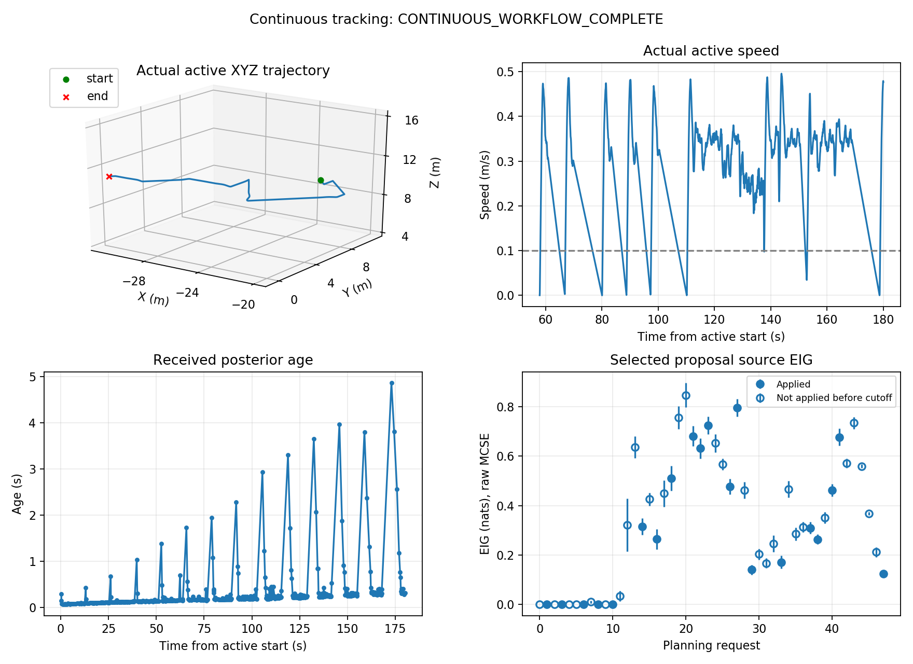

## 问题
目前在无人机上搭载TDLAS进行GSL和STE的时候，存在一个问题就是计算成本过高。导致计算成本过高的问题有以下几点：
    
    1、候选源在选择的时候直接铺满整个工作空间，导致如果想要定位误差较低，就要对候选源的分布间距更加细化，这就导致候选源的数量达到10000左右。

    2、利用扩散模型来进行TDLAS的CLI数值的预测的时候，目前不知道是因为PYTHON文件计算效率的问题，还是CLI离散化之后需要计算的点浓度太多的问题，导致计算成本过高

## 实践
    1、将候选源的选择方式向粒子滤波等更加自适应的方向区靠拢，尝试一下粒子滤波
    
    2、判断将python文件改为C++文件之后是否对计算时间的缩短有所帮助

    3、尝试将无人机的悬停飞行改为边飞边测看看效果如何

## 收获
    目前将文件改成C++对计算时间有了一定程度的降低，同时我也将无人机的自主闭环飞行变成了边飞边走，目前定位效果不错，但是候选源的收敛以及预测稳定性没有在180s内通过测试，之后需要在这方面以及更加快速的利用无人机的速度方面尝试一下。

