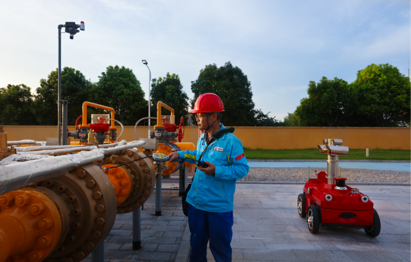
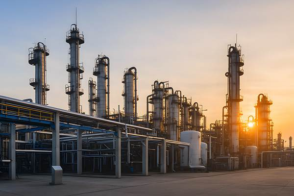
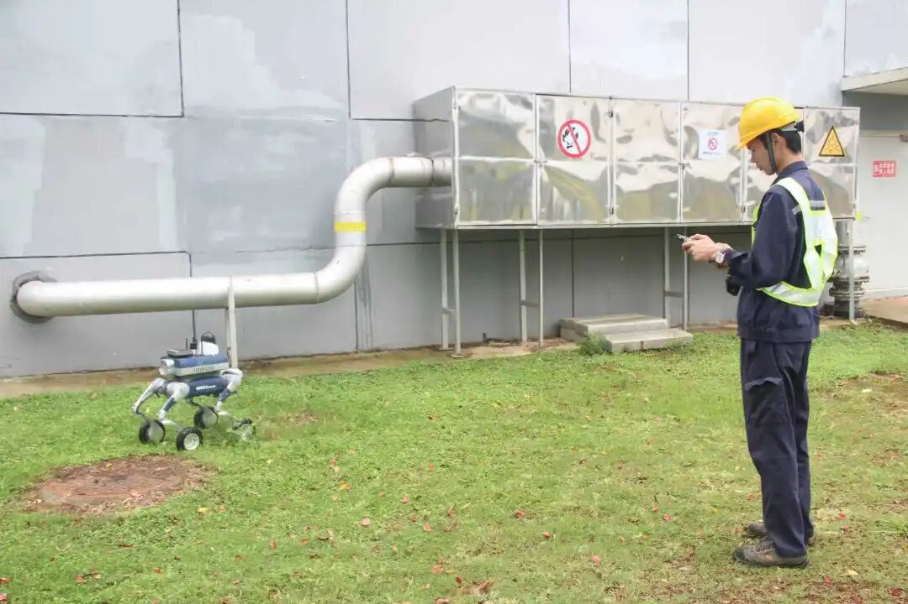

## 规划
本周有两个任务：
### 1、组会任务：
#### （1）UAV-TDLAS-GSL的任务在鲁棒性方面要通过提高计算速度和飞行速度、扩大无人机初始位置以及增加一个数据不同的风场来继续验证该任务的情况，并记录对应的数据，进行分析；
#### （2）UAV-TDLAS-GSL的任务在高精度方面要尝试粒子滤波的一些变种算法，寻找思路；
### 2、方向任务：
#### （1）针对UGV-TDLAS去寻找其的应用场景，首先从工业界搜索有没有公司是做两者结合的；再者从学术界搜索有没有相关方向的论文；之后再从TDLAS的应用场景入手。
#### （2）搭建地面的仿真环境，并验证其可行性；

## 实践
针对方向任务：UGV-TDLAS-GSL调研
### 1、从工业界方向调研
#### （1）存在利用UGV-TDLAS去进行应用，有以下几种场景：
##### |天然气厂管网巡检
 管网巡检环节，车载式激光甲烷检测车穿梭往来，其探测器发出的激光束可检测百米内管道、阀井，甚至穿透路面探测地下管线，精准识别甲烷泄漏，经二次复核消除误测，大幅提升检测效率。
 
 

#### |煤改气村庄巡检
#### |燃气管道巡检

#### |矿井/矿洞巡检

#### |高楼甲烷检测

总结：工业界中使用UGV-TDLAS在前四种场景中还是比较多的，说明是有实用价值的。
### 2、从学术界方向调研
#### |Arain, Muhammad Asif, et al. "Sniffing out fugitive methane emissions: autonomous remote gas inspection with a mobile robot." The International Journal of Robotics Research 40.4-5 (2021): 782-814.
这篇是使用地面小车和TDLAS进行GDM，并尝试通过GDM进行气味源头定位

#### |V. H. Bennetts, E. Schaffernicht, T. Stoyanov, A. J. Lilienthal and M. Trincavelli, "Robot assisted gas tomography — Localizing methane leaks in outdoor environments," 2014 IEEE International Conference on Robotics and Automation (ICRA), Hong Kong, China, 2014, pp. 6362-6367, doi: 10.1109/ICRA.2014.6907798.
同样是进行GDM

总结：目前使用地面机器人+TDLAS来做的大多数是GDM，很少集中在GSL上
